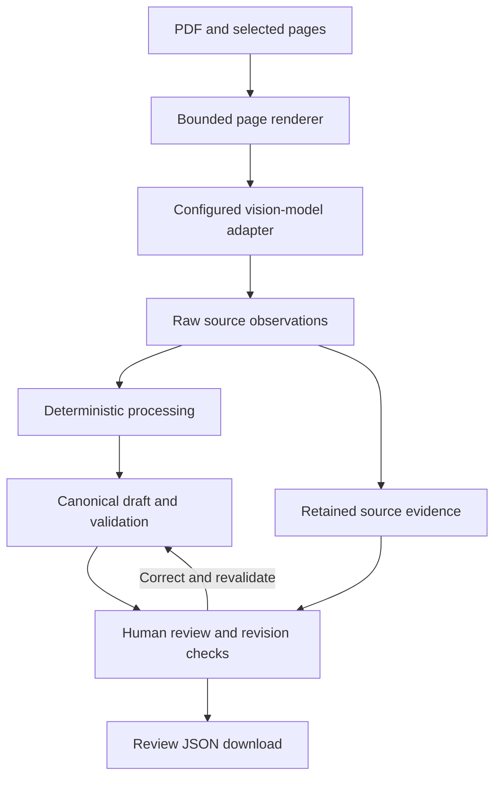

# Invoice Extraction & Review Workbench

[Back to portfolio](../README.md)

A local Python prototype for turning selected invoice PDF pages into reviewable invoice drafts. It combines vision-model extraction, deterministic validation and a browser-based correction workflow. The implementation retains source observations and unresolved rows alongside editable drafts, so a reviewer can inspect what was extracted, correct the draft and download review JSON.

## Stack

| Area | Stack |
| --- | --- |
| Core and data contracts | Python 3.12+, Pydantic, custom parsing and validation |
| PDF and image handling | pypdf, pypdfium2, Pillow |
| Model integration | HTTPX; one configurable OpenAI-compatible vision endpoint |
| Local application | Starlette, Uvicorn; packaged HTML, CSS and JavaScript |
| Verification tooling | pytest; optional Node/Playwright browser checks; benchmark and scoring tools |

## Architecture and workflow

The conversion core and server are separate distributions. The core defines provider-independent extraction and generic export interfaces. The server supplies the vision adapter and local review application. This keeps external request handling and the browser workflow outside the core conversion contracts.

Selected pages pass through a bounded renderer before a vision request produces raw source observations. Deterministic processing converts those observations into canonical drafts, then validation checks the result. Source evidence remains available separately from subsequent edits. Human corrections trigger revalidation, with revision checks coordinating updates to the review state.

The generic export interface is an extension point; the implemented local download is review JSON. A production spreadsheet or accounting exporter and master-data integration remain future work requiring confirmed target requirements.

## Engineering decisions

**Separate extraction from readiness.** A model response enters the workflow as observations. Explicit parsing, deterministic processing and canonical validation establish the next state. Conversion has explicit stopping states, while partial results and unresolved information can remain available for review. The AI integration therefore has a defined boundary before downstream use.

**Check completeness independently of arithmetic.** A partial set of invoice lines can balance even when source rows are missing. Source-coverage handling preserves that distinction: arithmetic consistency alone does not establish that extraction is complete. Unresolved rows remain part of the review problem rather than disappearing from the draft's context.

**Preserve evidence through correction.** The review model tracks editable drafts, retained evidence and correction provenance separately. Revision checks address conflicting updates, so stale review state is handled explicitly. Revalidation follows a correction, maintaining the connection between a human edit and the draft's validation status.

**Bound local processing.** Rendering, provider request/response handling and local job admission have explicit limits. The local application uses bounded in-memory state for a single session. Durable storage and multi-user operation are outside its current scope.

## Verification and demonstration

The repository contains architecture and contract tests, unit and integration tests, provider/rendering checks, and local service, web and review scenarios. Benchmark runners and scoring tools are also present. These descriptions are based on source inspection; no fresh tests, benchmarks or dataset evaluations were run for this portfolio. Production deployment and model performance are unverified.

The active extraction path uses one configured vision endpoint. Standalone OCR/reconstruction work remains planning or experimental material; automatic provider failover was not found in the inspected implementation.

A proposed walkthrough uses a synthetic PDF and mocked extraction response: select pages, inspect an incomplete source result, correct the draft, revalidate and download review JSON. Synthetic generation and network-free demo mechanisms provide a capture path. This walkthrough has not been executed; any future capture would be labeled synthetic and mocked. No screenshots are included because none have been cleared for publication.
