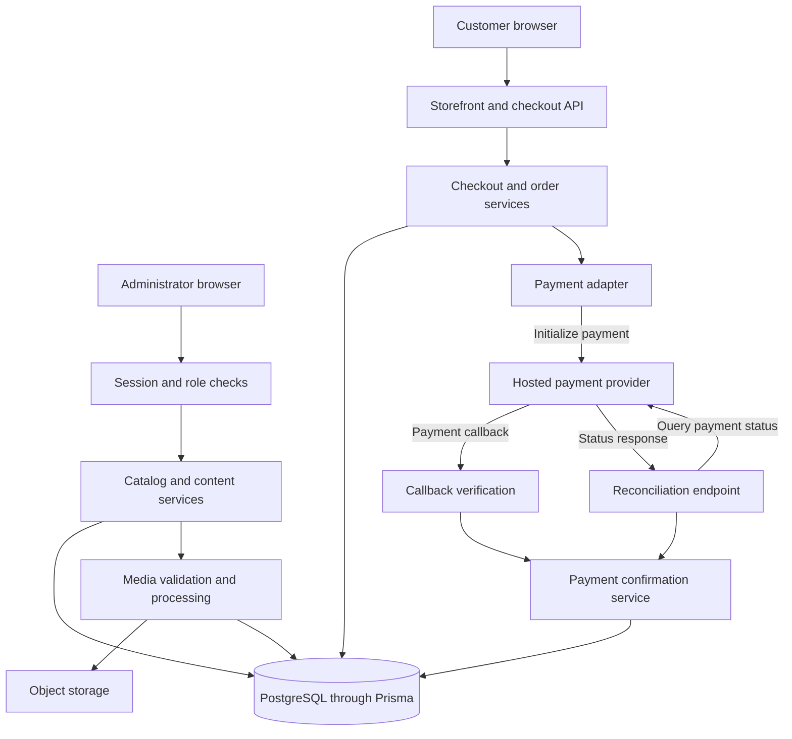

# LUCA

[Back to portfolio](../README.md)

LUCA is an ongoing e-commerce application that connects product discovery, guest checkout and hosted payments with catalog and content administration. Its implemented scope includes product browsing, a persistent cart, delivery or pickup selection, transactional order creation, payment confirmation and managed product media. The engineering focus is coordinating customer requests, database changes and external services when requests overlap or outcomes arrive late. Production acceptance remains unverified.

## Stack

| Area | Technologies |
|---|---|
| Application | Next.js 16, React 19, TypeScript 5, Tailwind CSS 4 |
| Persistence | Prisma 7, PostgreSQL |
| Administrative access | Better Auth, session and role checks |
| External services | HitPay integration, S3-compatible/R2 storage integration |
| Media and testing | Sharp, Vitest 4, Playwright |

Versions reflect dependency declarations.

## Implemented flows

Customers browse products and retain selections in a persistent client cart. Guest checkout recomputes prices on the server, checks the submitted quote and saves an order snapshot transactionally. Request replay controls handle repeated submissions. The order then enters a payment workflow with explicit initialization and confirmation states.

Administrative routes apply session and role checks before catalog and content operations. Product images move through temporary upload intents, validation, image processing and cleanup. Article editing includes concurrent-save conflict handling.

## Architecture

The storefront, administrative UI and HTTP endpoints share one Next.js application. Domain services organize order, payment, catalog and content workflows. Payment and storage adapters form boundaries around external services.

## Engineering challenges

- **Repeated checkout requests and stale quotes.** Server-side recomputation and quote checks establish the checkout boundary. Transactional order snapshots and replay controls coordinate persistence across repeated submissions. The stored snapshot also preserves the order information used by the payment workflow.
- **Database and provider coordination.** External payment initialization has outcomes that may be uncertain or delayed. Separate attempt and confirmation handling retains those states for resolution, while callback verification checks provider evidence before payment state changes. A reconciliation endpoint supplies a separate path that queries the provider; automated operation also requires a scheduling decision.
- **Storage and database lifecycle coordination.** Temporary upload intents, validation, image derivatives and cleanup coordinate stored objects with database metadata. This adds explicit intermediate states and cleanup responsibilities alongside the final catalog record.
- **Concurrent content editing.** Article saves detect edit conflicts at the service boundary. Conflicting edits become an explicit result that the administrative workflow must resolve, adding a user-visible recovery case to content management.

## Evidence and current limits

These descriptions are based on source inspection. Test infrastructure and scenarios are present for duplicate checkout, payment races, pickup concurrency, media finalization and concurrent article edits. CI defines checks and a selected browser suite. The application and tests were not run for this portfolio; no passing count or coverage claim is made.

Deployment and live payment/storage operation remain unverified. Payment reconciliation scheduling was not established by the inspected scheduler configuration.

## Potential walkthrough and next validation

A source-supported walkthrough could follow a synthetic catalog through cart and guest checkout, then show simulated payment states and a separate catalog/content administration flow. This walkthrough has not been executed.

The next validation work is to exercise these flows in a disposable environment, verify live integration behavior, establish and test reconciliation scheduling, and complete production acceptance checks.
