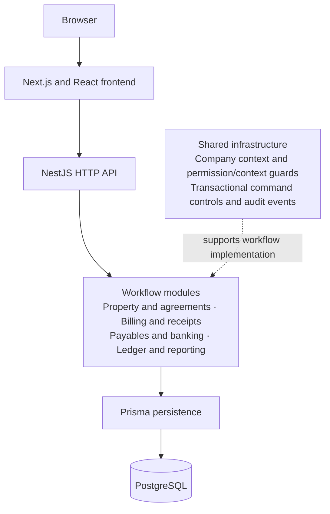

# Property Management & Accounting System

[Back to portfolio](../README.md)

An ongoing business application connecting property, tenant and agreement administration with billing, receipts, accounting records and reporting. Its engineering focus is the boundary between an operational action and the related financial records: a receipt, for example, involves more than saving a form. This descriptive title is a working label.

## Stack

| Layer | Technologies |
|---|---|
| Frontend | Next.js 15, React 19, TypeScript |
| Backend | NestJS 10, TypeScript |
| Persistence | Prisma 5, PostgreSQL |
| Tooling | pnpm workspace, Vitest |

Versions reflect declared dependencies. The application is organized as a TypeScript monorepo with a web frontend and a modular backend.

## Implemented workflows

The source contains wired backend modules and frontend navigation for:

- Property, tenant, agreement and deposit administration.
- Billing previews and runs, invoices and credit notes.
- Receipt posting, application and reversal; ledger records and reporting.
- Supplier bills and payments.
- Manual or CSV bank-statement ingestion and reconciliation.

Agreement-renewal UI and API work also exists on a development branch; it is not part of the merged main implementation.

## Architecture

The dotted connection represents shared capabilities, not a mandatory execution sequence or a verified security gate for every module. Workflow-oriented modules keep related operations together while sharing persistence and command infrastructure.

## Engineering decisions

**Connecting operational actions to accounting records.** Related workflows use shared transactional command infrastructure. That places transaction handling at a reusable command boundary across related operations. Audit-event infrastructure accompanies these operations, providing a separate record of actions alongside the resulting application state. The result is a common boundary for state changes and action history across workflows.

**Handling conflicting and repeated requests.** The command infrastructure combines serializable transactions, bounded retries and replay handling. These address different failure cases: concurrent operations can conflict, while a repeated request can attempt the same effect again. Bounded retries put a limit on transaction reattempts; replay controls give repeated commands an explicit handling path. Together, they give backend commands defined behavior for conflicts and duplicate submissions, including requests that arrive close together.

**Carrying company context across layers.** A shared frontend company selection and backend context guards make the active company explicit at workflow boundaries. This connects what the user is viewing with the scope used by backend operations. It also creates concrete boundaries for testing: company-isolation test files exist alongside command-retry and receipt-posting concurrency scenarios.

## Evidence and current limits

Unit, integration, end-to-end, database, concurrency and frontend test files are present. The application and test suites were not run for this case study, so passing results, coverage and accounting correctness remain unverified.

User and role management are incomplete, as is production identity integration. The default accounting identity adapter rejects requests; the alternate adapter is scoped to development and tests. Existing guards do not establish production-ready authentication, complete role-based access control or complete company isolation. Deployment and live bank connectivity are unverified; the implemented statement inputs are manual and CSV.

A future demonstration candidate is a synthetic property → agreement → billing → receipt walkthrough in a disposable local environment. It has not been executed.
